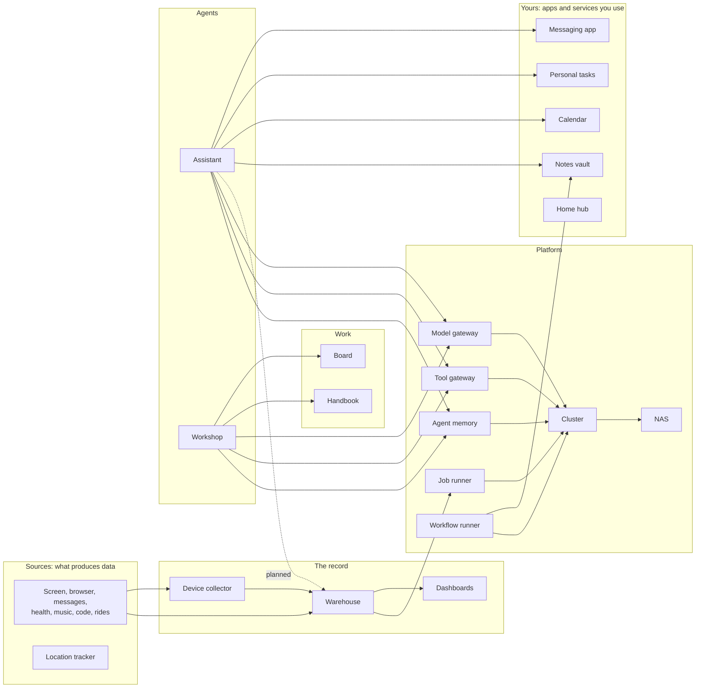
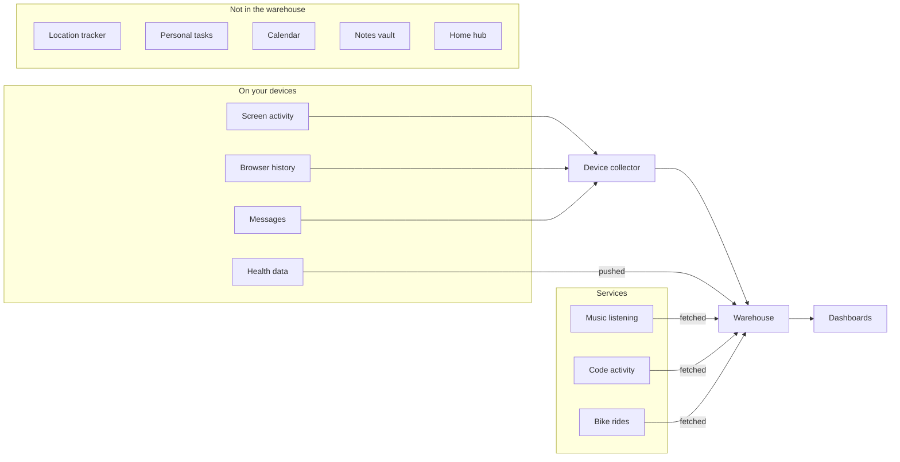

# Map

The connections are properties of each system page: `uses` (what it needs to run) and `feeds` (where its data goes). The drawings below are made from them, and are checked against them at each review. In Obsidian every box opens its page.

For one system in detail, open its page: the Related table lists everything that points at it, and the local graph shows its neighbours.

## The whole thing

A solid arrow is in place today. A dashed one is planned.

## What reaches the warehouse, and what does not

The location tracker keeps its own record. Nothing loads it into the warehouse.
