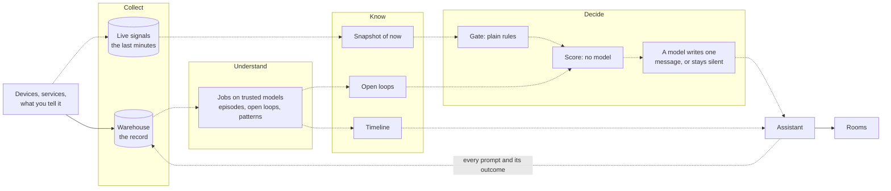

# The aware assistant

## Goal

An [assistant](../Systems/Assistant.md) that speaks at the right moment, not on the clock:

- A prompt arrives when you can act on it: free, in the right place, not in the middle of something. Staying silent is the default, because a badly timed assistant gets muted.
- It notices that a task slipped without being told, finds out why, and moves it somewhere it can succeed.
- Its own mistakes change how it behaves, and it reviews your systems (how you plan, file and review) with you.
- Telling it something costs one sentence to the phone, the watch or the chat.
- It serves the plan, its own building included: every project has its blocks in the calendar, and it says when one has run over.

Done when the assistant has sent two weeks of event-driven prompts within a daily budget, each logged with what you did next, and a slipped task is noticed and repaired without you saying so. These are milestones 4 and 5 of [the road](The%20road.md).

## The shape

A solid arrow works today, a dashed one is planned. Why it is built this way: [a small picture, not every feed](../Decisions/2026-11-19%20The%20assistant%20reads%20a%20small%20picture%2C%20not%20every%20feed.md), [rules first, a score second, a model last](../Decisions/2026-11-19%20The%20assistant%20speaks%20by%20rules%20first%2C%20a%20score%20second%2C%20a%20model%20last.md), [rooms by how much they may interrupt](../Decisions/2026-11-19%20Rooms%20are%20split%20by%20how%20much%20they%20may%20interrupt.md).

The assistant reads the picture through named tools on its tool gateway, each through a role that can only read the tables it needs, for a few seconds per query:

| Tool | Answers | Reads |
| --- | --- | --- |
| `now` | Where, what is in front, next event, what is open | Live signals, tasks, calendar |
| `day` | The timeline of one day, as episodes | Understood tables |
| `search` | "When did I look at X", "what did they say about Y" | Analysis tables, text indexes |
| `open_loops` | What is unfinished, with the evidence for each | Understood tables |
| `patterns` | When a kind of task gets done, which prompts land | Understood tables, the prompt log |
| `log` | Writes one line you told it | The log feed |

An open loop is something you promised, were asked, or started and did not finish. It is checked against later evidence before it is raised. Patterns are written as readable lines in the vault, and your correction of a line wins.

## Today

- The record works: the [warehouse](../Systems/Warehouse.md) receives from devices, apps and services, and its [page in home-ops](https://github.com/h-wb/home-ops/blob/main/kubernetes/apps/main/automation/miroir/README.md) says what it holds. Analysis is deterministic only (spans, sessions, counts).
- The assistant speaks on a clock: briefing, location review, midday nudge, evening check-in, reminders, weekly review, all delivered to one room, Inbox. Its mechanics: [Hermes](https://github.com/h-wb/home-ops/blob/main/kubernetes/apps/main/llm/hermes/README.md) and [wiring](https://github.com/h-wb/home-ops/blob/main/kubernetes/apps/main/llm/docs/wiring.md#the-assistant).
- It counts how often a task was postponed and asks "drop, shrink or block time" on the third slip.
- Collectors report every run; three alerts watch them. The routine that would turn alerts into messages exists but is switched off.
- None of the tools above exists. Its gateway lists the dashboard server's tools, which could query the warehouse free-form; nothing in its instructions does.

## The work

The steps in order, what is still to decide and to verify, and what is parked for later are on [the board](../Systems/Board.md), under HOMEL-43. Nothing of that list is kept here.

## Limits

- Anyone who messages you, and any page on your screen, can carry instructions, so the step that reads such text fills structured fields and calls nothing.
- An event-triggered run has nobody to approve a write.
- The phone's app usage arrives minutes late.
- A lit screen is not you at the keyboard.
- Every wake-up and every span summary is a paid call on one provider.
