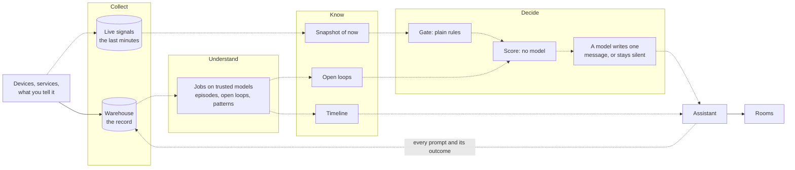

# The aware assistant

## Goal

An [assistant](../Systems/Assistant.md) that speaks at the right moment, not on the clock:

- A prompt arrives when you can act on it: free, in the right place, not in the middle of something. Staying silent is the default, because a badly timed assistant gets muted.
- It notices that a task slipped without being told, finds out why, and moves it somewhere it can succeed.
- Its own mistakes change how it behaves, and it reviews your systems (how you plan, file and review) with you.
- Telling it something costs one sentence to the phone, the watch or the chat.
- It serves the plan, its own building included: every project has its blocks in the calendar, and it says when one has run over.

Done when the assistant has sent two weeks of event-driven prompts within a daily budget, each logged with what you did next, and a slipped task is noticed and repaired without you saying so. These are milestones 4 and 5 of [the road](The%20road.md).

## The shape

A solid arrow works today, a dashed one is planned. Why it is built this way: [a small picture, not every feed](../Decisions/2026-11-19%20The%20assistant%20reads%20a%20small%20picture%2C%20not%20every%20feed.md), [rules first, a score second, a model last](../Decisions/2026-11-19%20The%20assistant%20speaks%20by%20rules%20first%2C%20a%20score%20second%2C%20a%20model%20last.md), [rooms by how much they may interrupt](../Decisions/2026-11-19%20Rooms%20are%20split%20by%20how%20much%20they%20may%20interrupt.md).

The assistant reads the picture through named tools on its tool gateway, each through a role that can only read the tables it needs, for a few seconds per query:

| Tool | Answers | Reads |
| --- | --- | --- |
| `now` | Where, what is in front, next event, what is open | Live signals, tasks, calendar |
| `day` | The timeline of one day, as episodes | Understood tables |
| `search` | "When did I look at X", "what did they say about Y" | Analysis tables, text indexes |
| `open_loops` | What is unfinished, with the evidence for each | Understood tables |
| `patterns` | When a kind of task gets done, which prompts land | Understood tables, the prompt log |
| `log` | Writes one line you told it | The log feed |

An open loop is something you promised, were asked, or started and did not finish. It is checked against later evidence before it is raised. Patterns are written as readable lines in the vault, and your correction of a line wins.

## Now

- The record works: the [warehouse](../Systems/Warehouse.md) receives from devices, apps and services, and its [page in home-ops](https://github.com/h-wb/home-ops/blob/main/kubernetes/apps/main/automation/miroir/README.md) says what it holds. Analysis is deterministic only (spans, sessions, counts).
- The assistant speaks on a clock: briefing, location review, midday nudge, evening check-in, reminders, weekly review, all delivered to one room, Inbox. Its mechanics: [Hermes](https://github.com/h-wb/home-ops/blob/main/kubernetes/apps/main/llm/hermes/README.md) and [wiring](https://github.com/h-wb/home-ops/blob/main/kubernetes/apps/main/llm/docs/wiring.md#the-assistant).
- It counts how often a task was postponed and asks "drop, shrink or block time" on the third slip.
- Collectors report every run; three alerts watch them. The routine that would turn alerts into messages exists but is switched off.
- None of the tools above exists. Its gateway lists the dashboard server's tools, which could query the warehouse free-form; nothing in its instructions does.

## Next

In order. Each step is a sub-issue of HOMEL-43 on [the board](../Systems/Board.md).

1. Spine: the Now room and a room per routine, a daily budget for Now starting at three, exact-time reminders sent without a model, and the `now` snapshot from tasks, calendar, place and the Mac's state.
2. The plan in the calendar, then mail and calendar tools. Your part first: the weekly things (workouts, meals, time for each project, this one included) go in the calendar as real blocks. Then tools that read mail and the calendar and write the calendar; today it sees only the events the task service shows.
3. Live path: the home hub's apps on the phone and the Mac, the assistant's wake-up route, one rule and one kind of prompt ("home, thirty free minutes, here is one task"), and the prompt log from the first prompt. Two weeks of use before adding anything.
4. Messages on the always-on Mac every minute, and the new-message doorbell.
5. Understand jobs: span summaries and the `day` tool, then open loops from messages and mail.
6. The log feed: voice, watch, chat.
7. Missed-task detection, the autonomy ladder (tell, propose, do and tell, do silently; up after repeated yeses, down on one correction) and calendar writes.
8. System review: the weekly review proposes changes to its own rules and to your systems. A change to rules or routines is a change in git, so it goes to the workshop.

Alongside, in a free week: a trial of Screencap beside ScreenMemory.

Later: other chat networks, a contacts source so the same person lines up across networks, phone app usage, a decision model if the replay test supports one.

## Open

To decide:

- Which mail and calendar providers the tools reach.
- Where the gate's rules live: the home hub's automations (proposed) or a small service of our own.
- Whether raw screenshots may go to the trusted provider for spans with little text. You said yes on 2026-11-19; the masking limits were found after: screenshots cannot be masked at all.

To verify:

- The home hub's apps report focus mode and the front app fast enough.
- The wake-up route works, and a run it starts can deliver to a named room.
- Three prompts a day in Now is the right budget, after two weeks.
- The trusted models write span summaries and extract open loops well enough.

Limits to keep in view: anyone who messages you, and any page on your screen, can carry instructions, so the step that reads such text fills structured fields and calls nothing; an event-triggered run has nobody to approve a write; the phone's app usage arrives minutes late; a lit screen is not you at the keyboard; every wake-up and every span summary is a paid call on one provider.
